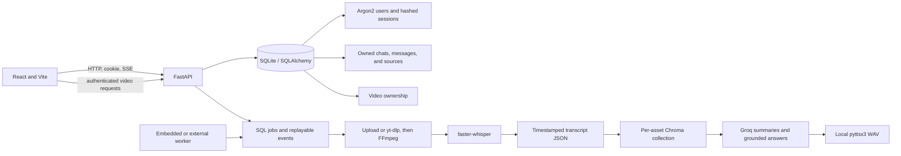

# VideoMind Project Recap

This document describes the implementation currently in the repository. The code and tests are authoritative if details change.

## System Overview

VideoMind is a local-first FastAPI and React/Vite application. A signed-in user uploads a media file or submits a YouTube URL, receives a timestamped transcript and structured summary, and asks grounded questions about that video. User accounts, sessions, video ownership, and chats are persisted in a SQL database (SQLite by default); media and derived artifacts remain local files.



## Source Map

| Path | Responsibility |
|---|---|
| `backend/app/main.py` | Creates the FastAPI app and registers auth, chat, health, and video routers. |
| `backend/app/ports/`, `backend/app/adapters/`, `backend/app/container.py` | Define external dependency protocols, local concrete adapters, and the single application composition root. |
| `backend/app/api/auth.py`, `dependencies.py` | Registration, login, `/auth/me`, logout, and current-session dependency. |
| `backend/app/api/chats.py` | Authenticated chat CRUD, Q&A, answer-audio generation/playback. |
| `backend/app/api/videos.py`, `backend/app/api/account.py` | Authenticated ingestion, status/SSE, media, transcript, summary, question/audio, video deletion, and account-data deletion routes. |
| `backend/app/db/`, `backend/app/repositories/`, `backend/migrations/` | SQLAlchemy models, SQLite connection setup, repositories, and Alembic schema migration. |
| `backend/app/adapters/sql_job_queue.py`, `backend/worker.py` | Atomic database job claims, heartbeats, stale recovery, and configurable embedded/external workers. |
| `backend/app/services/auth.py`, `user_storage.py` | Argon2 password handling and database-backed user/session access; session tokens are stored as hashes. |
| `backend/app/services/chat_storage.py` | Database-backed chat persistence and canonical video-context hydration. |
| `backend/app/services/video_storage.py`, `asset_cleanup.py` | Per-video ownership, shared asset lookup, and last-reference artifact cleanup. |
| `backend/app/services/video_processing.py`, `media.py` | Idempotent, checkpointed processing stages and timestamped transcription orchestration. |
| `backend/app/services/rag.py` | Timestamp-preserving chunks, injected vector and embedding ports, similarity filtering, transcript fallback selection. |
| `backend/app/services/llm.py`, `voice.py` | Injected LLM/TTS ports, grounded Q&A and summaries, and voice-question flow. |
| `frontend/src/App.tsx` | Theme persistence, login/register, session restoration, logout and expiry handling. |
| `frontend/src/VideoChatWorkspace.tsx` | Chat/video selection, ingestion, SSE/status refresh, chat questions and view state. |
| `frontend/src/WorkspaceComponents.tsx` | Sidebar, full chat history, composer, collapsed sources, audio controls, video/context panels. |
| `frontend/src/api.ts`, `styles.css` | Typed cookie-backed requests and shared responsive/theme styling. |
| `scripts/vanish.py` | Standalone runtime-data cleanup and empty SQLite schema recreation. |
| `scripts/migrate_json_to_db.py` | Idempotent importer for legacy user, chat, and video-owner JSON. |
| `scripts/migrate_videos_to_assets.py` | Idempotent SHA-256 migration for existing video rows and local artifacts. |

Business services depend on ports rather than concrete adapters. FastAPI dependencies read the composed services from `backend/app/container.py`; the local blob adapter continues to store runtime artifacts under the same `data/` paths.

## Authentication and Data Ownership

- Usernames are normalized and stored with Argon2 password hashes in SQL.
- Login sets an HTTP-only, SameSite=Lax cookie. Session IDs are random; only their SHA-256 hashes are stored in SQL, with a 12-hour expiration.
- `/auth/me` restores a session after refresh. The frontend does not store passwords or session identifiers in local storage. Only the selected theme is stored in `videomind.theme`.
- Chats, messages, and message sources are stored in relational tables; message and source rows cascade on chat deletion. Reads, updates, deletes, message writes, and chat answer-audio access use the authenticated username; foreign chat IDs return `404`.
- Upload and YouTube routes assign the new video ID to the authenticated user in SQL before processing. Identical uploaded files share a `media_assets` record and canonical blob, while ownership remains attached to each distinct video row. All video routes, including SSE, media playback, transcript, summary, voice audio, and Q&A, check ownership. Creating or updating a chat also checks its video association.
- Legacy owner mappings can be imported from `data/videos/.owners.json`; unowned artifacts are not auto-claimed.
- Sessions remain durable across application restarts; only SHA-256 token hashes are persisted, with expired sessions purged at startup and hourly. Cookie Secure behavior follows `COOKIE_SECURE` (defaults on for `APP_ENV=production`) and unsafe methods enforce the configured Origin/Referer allowlist. SlowAPI's in-memory limiter provides configurable login, registration, ingestion, and question limits. Uploads are magic-byte checked and duration-probed; YouTube inputs are host-restricted, playlist-disabled, and subprocess-time-limited. Per-user video and total-minute quotas are configured through environment settings.

## Video and Chat Workflows

1. `POST /videos/upload` or `POST /videos/youtube` returns `202` and a generated 32-character lowercase hexadecimal `video_id`; both require a signed-in account. Uploads are hashed while streaming and identical bytes reuse their shared asset; a completed asset is returned as completed without another processing job.
2. Upload sources persist once under `data/videos/assets/{asset_id}{extension}`; YouTube downloads remain under `data/videos/{video_id}{extension}`. FFmpeg's normalized audio is checkpointed under `data/audio/extracted/` using the asset ID for uploads or the video ID for YouTube; job state and replayable events are stored in SQL.
3. Processing writes timestamped segments to `data/transcripts/{artifact_id}.json`, indexes a Chroma collection named `video_{artifact_id}`, writes a structured summary to `data/summaries/{artifact_id}.json`, and generates summary audio under `data/audio/summaries/` when dependencies are available. For uploads, `artifact_id` is the shared asset ID; for YouTube, it is the video ID.
4. The embedded worker (default) or `python -m backend.worker` in external mode claims jobs from SQL, heartbeats the claim, and checkpoints each completed stage. Stale claims are re-queued; output artifacts let resumed stages skip completed work. The frontend listens to owner-checked, database-backed SSE events and refreshes status.
5. **New Chat** creates another SQL chat using the selected, already-processed `video_id`. It does not upload, download, or reprocess the source.
6. Reopening a chat restores the complete ordered message history. Transcript and summary are resolved from canonical video artifacts rather than copied into each chat unless supplied explicitly.
7. Chat Q&A saves the user message, sends only the latest three prior user/assistant messages as conversational context, retrieves evidence only from that video's collection, then saves the assistant answer, timestamped sources, and optional audio reference. Full persistent history is never sent wholesale to Groq.
8. Weak retrieval falls back to question-focused raw transcript excerpts capped at 12,000 characters. The RAG policy uses `top_k=5`, `MIN_SIMILARITY=0.70`, and `RELATIVE_MARGIN=0.10`. Sources are collapsed per answer and timestamps seek the video player.

Deleting one video detaches its chats and marks them `video_missing`. It removes the canonical source, transcript, summaries, audio, and vector collection only when that video was the asset's final reference. `DELETE /me/data` removes the current user's chats, sessions, and video rows while preserving assets still referenced by another user. `scripts/migrate_videos_to_assets.py` links legacy source files by SHA-256 and cleans duplicate video-keyed artifacts; run its `--dry-run` first after backing up runtime data.

Standalone video Q&A and voice-question routes share the same video-scoped RAG pipeline. Voice-question audio is temporary/query-only and is not added to the transcript index. Chat answer audio has owner-checked chat/message routes and stores only a reference in chat JSON, not WAV bytes.

## Frontend Behavior

The default theme is **Dark Modern**; **Solarized Light** is also available and persisted in browser local storage. The authenticated workspace has New Video, New Chat, Summary, Video, Transcript, existing chats, complete message history, and a bottom composer. On narrow screens the sidebar is a drawer. Sources are collapsed by default. Answer-audio controls are explicit-click and expose loading, playing, and retry states.

API calls include browser credentials. In-flight duplicate GETs are coalesced, and the request cache is invalidated at login/logout and protected-session expiry. Chat loads use a request sequence so late responses cannot replace a newer selection; switching chats clears the prior video context immediately.

The workspace also enforces a visible chat/video mismatch guard. If a selected chat is associated with a different `video_id` than the currently active context, the composer is disabled and a warning is shown until the user loads that chat's own video context. This prevents a confusing ask against the wrong video while still keeping the backend authorization checks as the final authority.

Chat deletion is exposed in the left-hand list as an explicit trash action. Selecting it opens a confirmation modal and then sends `DELETE /chats/{chat_id}` using the current authenticated session. The UI refreshes immediately and removes the deleted chat from the active workspace state.

The summary panel includes a dedicated summary-audio control. Clicking it fetches `GET /videos/{video_id}/summary/audio`, plays the generated audio with a browser `Audio` object, and exposes a pause or retry state while keeping the control explicit rather than autoplaying on load.

## Runtime Data and Vanish

Runtime data is below `data/`: `videomind.db` (including SQLite sidecars), `videos/` (legacy `.owners.json` may remain until migrated/cleaned), `audio/`, `transcripts/`, `summaries/`, `chroma/`, `users/`, and `chats/` (legacy JSON may remain until imported/cleaned). `python scripts/vanish.py` clears the seven runtime directories, deletes `data/videomind.db*`, and recreates an empty schema. It preserves source code, configuration, dependencies, `.git`, project caches outside the allowlist, and any unlisted content directly under `data/`.

The API starts an embedded job worker by default. Set `WORKER_MODE=external` to run `python -m backend.worker` separately. `MAX_CONCURRENT_JOBS` defaults to `1` per worker process. Jobs heartbeat while running; expired claims are re-queued, and completed stages are skipped using persisted checkpoints and outputs. `GET /videos/{id}/events` polls durable events and honors `Last-Event-ID` for reconnect replay.

## Setup and Verification

From **Command Prompt (cmd.exe)** at the repository root:

```cmd
py -3.13 -m venv .venv
.venv\Scripts\activate
python -m pip install -r requirements.txt
python -m alembic upgrade head
cd frontend
npm ci
npm run build
cd ..
python -m pytest
```

Install Node.js and FFmpeg separately from Python packages. Check `node --version`, `npm --version`, and `ffmpeg -version` in a new terminal; if FFmpeg is not found, add its executable folder to Windows `PATH`. Set `GROQ_API_KEY` in the untracked local `.env`. ASR and embedding models may download on first use; local TTS requires a usable Windows SAPI voice. Tests mock external services and do not require a Groq credential.

For an existing JSON installation, validate and then run `python -m scripts.migrate_json_to_db --dry-run` and `python -m scripts.migrate_json_to_db` from the repository root. Start the backend from the repository root with `.venv\Scripts\activate` followed by `uvicorn backend.app.main:app --reload`. The database defaults to `sqlite:///data/videomind.db`; set `DATABASE_URL` in `.env` to change it. In a second terminal, start Vite from `frontend\` with `npm run dev`; the configured `/api` proxy targets `http://127.0.0.1:8000`.

## Known Limitations

- Job records and events are database-backed, and multiple worker processes claim jobs transactionally. Session records are persisted in SQL and expire after 12 hours; in-flight work depends on local artifacts and the shared configured database.
- Runtime database, media, audio, and Chroma data are local to one machine. This is not a distributed or production storage design.
- Rate limiting uses in-memory storage and is local to one API process. Public or multi-process deployments still need a deliberate security and operations review.
- Processing is resource-intensive and may require FFmpeg, model downloads, Groq access, disk space, and a Windows SAPI voice.
